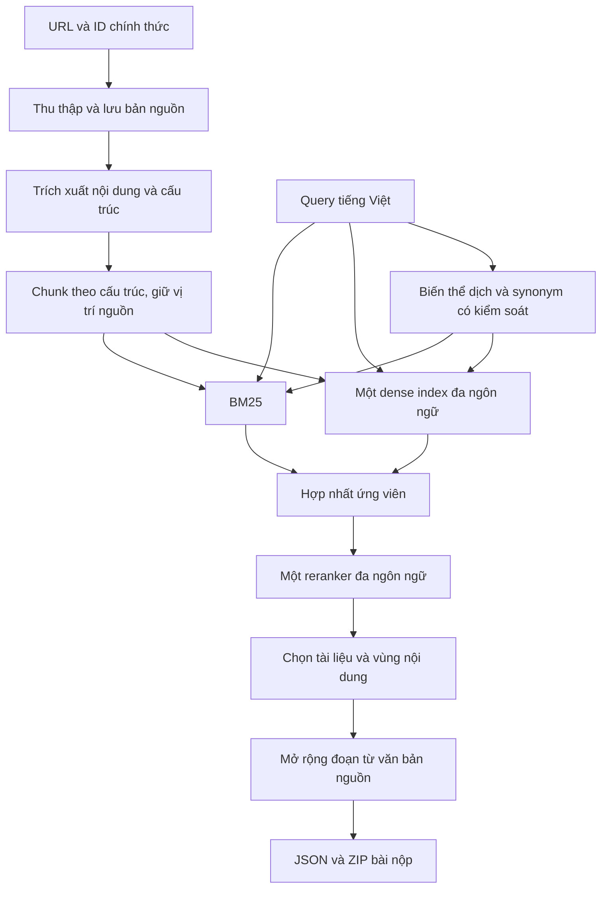

# Giải pháp ViBioMIR — Version 1

**Phiên bản:** 1.0  
**Ngày:** 09/10/2026 (UTC+07:00)  
**Trạng thái:** Đề xuất thiết kế; chưa triển khai hoặc benchmark hệ thống.

Tài liệu này mô tả giải pháp ban đầu cho MedXIR, dựa trên quy định cuộc thi, khảo sát trực tiếp dữ liệu được cấp và đánh giá chi phí–lợi ích của các phương pháp truy hồi. Các quyết định về model, số lượng ứng viên và ngưỡng chọn kết quả sẽ được chốt bằng thực nghiệm.

## 1. Mục tiêu và phạm vi

Với mỗi câu hỏi y khoa bằng tiếng Việt, hệ thống cần tìm các tài liệu và đoạn văn bản liên quan trong corpus đa ngôn ngữ, sau đó xuất ID tài liệu cùng đoạn trích nguyên bản. Hai đầu ra được đánh giá riêng ở cấp document và chunk.

Đội thi tự xây dựng toàn bộ quy trình từ danh sách URL: thu thập, trích xuất, phân đoạn, lập chỉ mục, truy hồi và chọn kết quả. Trong phiên bản đánh giá hiện tại, chỉ tài liệu có ID thuộc `links_corpus.parquet` được tính là nhãn dương.

Mục tiêu của V1 là tạo một pipeline có thể chạy từ dữ liệu nguồn đến bài nộp hợp lệ, đo được chất lượng và chi phí từng tầng. Ưu tiên đầu tư vào độ phủ corpus, độ chính xác của văn bản trích xuất, truy hồi đa ngôn ngữ và cách chọn tập kết quả theo F2.

Theo [OVERVIEW.md](OVERVIEW.md), mô hình sử dụng phải được công khai theo quy định, có kích thước không quá 15B và phát hành trước ngày 01/08/2026. Khi chọn checkpoint, cần ghi model ID, revision, ngày phát hành và cấu hình sử dụng; các bước dịch, mở rộng query hoặc tạo dữ liệu bổ trợ cũng phải tuân thủ quy định này.

## 2. Những gì đã biết về dữ liệu

Các số dưới đây được đọc trực tiếp từ hai file Parquet trong `dataset/` ở thời điểm khảo sát, thay vì chỉ lấy từ README.

| Đặc điểm | Kết quả |
| --- | ---: |
| Số truy vấn | 1.200 |
| ID truy vấn | 1–1.200, không trùng |
| Nội dung truy vấn | Không trùng, không rỗng |
| Số bản ghi corpus | 4.394.718 |
| ID tài liệu | Nhỏ nhất 583, lớn nhất 4.420.561; có khoảng trống |
| URL | Không trùng, không rỗng |
| Số host khác nhau | 97 |

README ghi 4.420.561 liên kết, khác số bản ghi trong file hiện có. Hệ thống phải lấy danh sách ID thực tế làm căn cứ; không tạo ID bằng số thứ tự dòng hoặc giả định ID liên tục.

| Host lớn nhất | Số URL |
| --- | ---: |
| `www.cnkang.com` | 963.438 |
| `www.120ask.com` | 918.479 |
| `www.familydoctor.com.cn` | 447.453 |
| `ask.39.net` | 337.375 |

Bốn host này chiếm khoảng 60,68% corpus. Trong danh sách host đã khảo sát chưa thấy PubMed/PMC. Đây là căn cứ ưu tiên khảo sát nguồn tiếng Trung và tiếng Việt, nhưng chưa đủ để kết luận tỷ lệ ngôn ngữ của nội dung hay phân bố nhãn liên quan. Ngôn ngữ phải được xác định từ văn bản tải về.

Các truy vấn đã xem gồm câu hỏi về triệu chứng, xét nghiệm, thuốc, trẻ em và tình huống cá nhân, chẳng hạn:

> “Răng có lỗ chấm đen, chảy máu khi thức dậy là sao?”

> “Con tôi 10 tháng bị sốt hết rồi giờ phát ban khắp người có sao không”

> “Suy giảm thị lực có phải do đau đầu hay tác dụng phụ của Topiramate?”

Mẫu này gợi ý rằng tuổi, thời gian, phủ định, diễn tiến và quan hệ giữa triệu chứng với thuốc có thể ảnh hưởng mạnh đến độ liên quan. Cần giữ những chi tiết đó khi xử lý query. Đây mới là quan sát trên mẫu, chưa phải phân loại toàn bộ 1.200 câu hỏi.

Hai file được cấp chỉ có `id/query` và `id/url`. Chưa có nội dung tài liệu, nhãn ngôn ngữ, chunk hay nhãn liên quan trong dữ liệu cục bộ.

## 3. Cách chấm quyết định thiết kế

Theo [EVALUATION.md](EVALUATION.md), Precision, Recall và F2 được tính cho từng truy vấn rồi lấy trung bình macro. Cần báo cáo riêng hai cấp document và chunk; tài liệu hiện có chưa quy định cách kết hợp chúng thành một điểm chung.

Ở cấp document, với tập dự đoán D và tập tham chiếu G:

```text
Precision = |D ∩ G| / |D|
Recall    = |D ∩ G| / |G|
F2        = 5 × Precision × Recall / (4 × Precision + Recall)
```

Khi các tập có phần tử, F2 cũng có thể viết thành `5 × TP / (4 × |G| + |D|)`. Recall được ưu tiên, nhưng tăng số tài liệu vẫn có thể làm giảm điểm. Ví dụ G có 10 tài liệu: dự đoán 10 và đúng 8 cho F2 = 0,80; dự đoán 20 và đúng 9 cho F2 = 0,75.

Ở cấp chunk, văn bản được chuẩn hóa NFKC, giải mã HTML entity, chuyển chữ thường và gộp khoảng trắng. Một chunk được tính đúng khi khớp một chunk tham chiếu thuộc cùng truy vấn và cùng `doc_id`, với:

```text
overlap(c, g) = LCS_tokens(c, g) / |g| >= 0,40
```

LCS giữ thứ tự token nhưng không yêu cầu các token liên tiếp. Mẫu số là độ dài chunk tham chiếu. Nếu mở rộng chunk dự đoán mà giữ nguyên chuỗi token ban đầu, LCS không giảm; công thức overlap không phạt trực tiếp phần văn bản nguồn được thêm vào.

Các hệ quả cho thiết kế:

- Đánh giá riêng đơn vị dùng để tìm kiếm và vùng văn bản dùng để nộp. Có thể tìm bằng chunk nhỏ rồi xuất một cửa sổ nguồn rộng hơn.
- Thử đoạn đơn, đoạn cùng hàng xóm, section và toàn bộ nội dung chính của bài hỏi đáp ngắn.
- Theo đặc tả hiện tại, đổi thứ tự cùng một tập kết quả không đổi các chỉ số. Reranker cần giúp chọn tập kết quả hoặc vùng văn bản tốt hơn.
- Điều chỉnh số lượng kết quả và ngưỡng giữ lại bằng thực nghiệm, tránh chốt top-K cố định theo trực giác.

Các điểm chưa rõ cần đối chiếu với scorer chính thức: tokenizer; giới hạn độ dài và số chunk; cách tính recall khi một chunk khớp nhiều nhãn; xử lý chunk trùng; và quy ước cho tập rỗng. Kết luận về lợi ích của mở rộng chunk còn phụ thuộc các chi tiết này.

## 4. Kiến trúc đề xuất cho V1



Nhánh dịch và synonym được bật sau khi có baseline để đo lợi ích bổ sung. Mỗi tầng phải lưu đầu ra đủ để phân tích lỗi và chạy lại các thử nghiệm mà không phải thu thập hay embedding lại toàn bộ dữ liệu.

### 4.1. Thu thập và trích xuất

Lập danh sách công việc theo host, lưu trạng thái tải, mã HTTP, URL sau chuyển hướng, thời điểm thu thập và lỗi. Hỗ trợ tiếp tục công việc còn thiếu và retry có kiểm soát. Lưu bản nguồn để có thể sửa parser mà không tải lại.

Khảo sát mẫu trang theo host và loại trang trước khi mở rộng thu thập. Đo tỷ lệ tải thành công, lấy được nội dung chính, giữ được câu trả lời và mức nhiễu từ menu/quảng cáo. Ưu tiên nguồn theo cả quy mô, khả năng thu thập và đóng góp đo được vào truy hồi; tiếp tục mở rộng các nguồn còn lại để tránh mất độ phủ.

Parser cần giữ tiêu đề, heading, đoạn văn, danh sách, bảng và cấu trúc hỏi–đáp. Trang chỉ lấy được navigation hoặc thông báo lỗi phải được nhận diện. Tránh loại cả một host hay chủ đề chỉ vì đánh giá chất lượng y khoa chủ quan: mục tiêu chấm là truy hồi nhãn liên quan trong corpus.

Nếu gộp nội dung trùng để giảm chi phí, vẫn giữ ánh xạ đến các ID nguồn. Không tự động xuất mọi ID trong một nhóm trùng; lựa chọn đó cũng cần đánh giá vì có thể tăng số dự đoán sai.

### 4.2. Văn bản nguồn và phân đoạn

Mỗi tài liệu giữ ID chính thức, URL, ngôn ngữ được phát hiện, nội dung chính và vị trí các khối văn bản. Mỗi chunk giữ quan hệ với document, section và đoạn liền kề.

Hai biểu diễn cần được quản lý rõ ràng:

| Biểu diễn | Mục đích |
| --- | --- |
| `embedding_text` | Có thể thêm tiêu đề và đường dẫn section để tăng ngữ cảnh |
| `source_text` cùng vị trí nguồn | Dùng dựng đoạn trích nộp; truy ngược được về tài liệu |

Quy tắc ban đầu: giữ nguyên bài hỏi đáp ngắn nếu nằm trong giới hạn đầu vào; chia bài dài theo heading và đoạn; section quá dài mới chia theo câu và giới hạn token. Overlap là một cấu hình thử nghiệm, vì nó cũng làm tăng số vector và ứng viên lặp.

Chưa chốt kích thước 400–700 token. Cần đo phân bố độ dài, giới hạn tokenizer của model và lỗi mất ngữ cảnh. Semantic chunking bằng embedding chỉ được bổ sung khi lỗi ranh giới có ảnh hưởng đáng kể.

### 4.3. Query và truy hồi ứng viên

Luôn giữ query gốc. Các biến thể dịch phải bảo toàn tuổi, phủ định, thuốc, giá trị xét nghiệm, thời gian và các ý hỏi. Không biến suy đoán chẩn đoán thành điều kiện truy hồi bắt buộc.

Thử dịch VI→ZH sớm dựa trên phân bố nguồn hiện có. VI→EN được đánh giá theo corpus tiếng Anh thực sự thu thập được. Synonym ban đầu giới hạn ở tên đồng nghĩa, viết tắt và tên hoạt chất có độ tin cậy cao. Với 1.200 query, có thể xử lý một lần và cache theo model, prompt và phiên bản cấu hình.

BM25 sử dụng cách phân tích văn bản phù hợp với từng ngôn ngữ. Đặc biệt, cách tách token tiếng Trung phải được kiểm tra. Dense retriever sử dụng một model đa ngôn ngữ, chạy query gốc xuyên ngôn ngữ và thử thêm biến thể khi có lợi ích.

Qwen3-Embedding-0.6B và 4B là ứng viên so sánh ban đầu; 8B được cân nhắc khi mức tăng chất lượng xứng đáng với tốc độ và tài nguyên. Chọn model trên tập dữ liệu đại diện trước khi embedding toàn corpus.

Hợp nhất ứng viên bằng RRF là cấu hình xuất phát:

```text
RRF(x) = Σ weight_m / (k + rank_m(x))
```

Không cộng trực tiếp vector từ các model có không gian khác nhau. Khi một nhánh có nhiều bản dịch hoặc mở rộng, cần kiểm soát tổng trọng số để tránh được ưu tiên chỉ vì có nhiều biến thể. Theo dõi số chunk và số document riêng biệt trong tập ứng viên; nhiều chunk của một document có thể chiếm hết ngân sách reranking.

### 4.4. Reranking và chọn kết quả

Sử dụng một reranker đa ngôn ngữ; Qwen3-Reranker-4B là ứng viên, với bản 0.6B làm đối chứng chi phí. Số ứng viên rerank được chọn dựa trên recall ở bước truy hồi và thời gian xử lý thực tế.

Ở cấp document, so sánh cách lấy điểm chunk tốt nhất với cách tổng hợp một số đoạn bằng chứng khác nhau. Tránh để tài liệu dài được lợi đơn thuần vì có nhiều chunk. Ở cấp chunk, chọn các vùng nguồn có liên quan và kiểm soát đoạn lặp.

Thử riêng ngưỡng và số lượng kết quả cho hai đầu ra. Điểm reranker chưa phải xác suất liên quan đã được hiệu chỉnh. Cấu hình có số lượng kết quả thay đổi theo query chỉ được dùng khi kiểm chứng tốt hơn top-K trên tập đánh giá.

### 4.5. Xuất bài nộp

Đầu ra gồm toàn bộ 1.200 ID query với `relevant_docs` và `relevant_chunks`; trường không có kết quả dùng danh sách rỗng. ID tài liệu dựa trên giá trị số nguyên trong corpus theo mô tả của [SUBMISSION.md](SUBMISSION.md); ví dụ dùng chuỗi trong tài liệu hiện chưa nhất quán với mô tả này.

`chunk_text` được trích từ nguồn, bảo toàn nội dung và thứ tự. Tách cấu hình xuất đoạn khỏi cấu hình embedding để thử cửa sổ nguồn rộng hơn mà không lập lại index.

Kiểm tra đủ query, đúng kiểu dữ liệu, ID tài liệu tồn tại, `chunk_order` hợp lệ nếu có và đoạn trích truy ngược được về nguồn. ZIP chứa duy nhất một JSON ở thư mục gốc theo đặc tả.

## 5. ROI và các hướng nâng cấp

ROI trong tài liệu là mức ưu tiên dự kiến, chưa phải mức tăng điểm đã đo. Chi phí cần xét cả thời gian kỹ thuật, GPU, dung lượng, thời gian chạy và khả năng dùng lại hạ tầng.

| Hạng mục | Ưu tiên V1 | Điều kiện hoặc lý do |
| --- | --- | --- |
| Thu thập, parser, giữ văn bản và ID | Rất cao | Tạo corpus mà các tầng sau có thể tìm kiếm |
| Bộ đánh giá và phân tích lỗi | Rất cao | Cho phép ra quyết định bằng số liệu |
| Chunk theo cấu trúc, giữ hỏi–đáp | Cao | Chi phí thấp, dễ kiểm tra |
| BM25 + một dense retriever | Cao | Baseline hybrid có hai cách tìm ứng viên |
| Dịch query, synonym giới hạn | Thử sớm | Chi phí chủ yếu trên 1.200 query, cache được |
| Một reranker | Thử sớm | Cải thiện lựa chọn tập kết quả |
| Mở rộng đoạn và điều chỉnh tập nộp | Cao | Tác động trực tiếp metric, ít chi phí lập index |
| UMLS + CODER/SapBERT | Có điều kiện | Chứng minh lợi ích hơn dịch/synonym đơn giản |
| BMRetriever/MedCPT | Có điều kiện | Phụ thuộc phần corpus tiếng Anh hữu ích |
| LLM judge hoặc NLI | Để sau | Cần chứng minh lợi ích bổ sung sau reranker |
| Semantic chunking, late chunking, RAPTOR | Hoãn | Chi phí và độ phức tạp cần được biện minh bằng lỗi thực tế |

UMLS đáng thử khi lỗi liên quan đến thuật ngữ hoặc liên kết concept xuất hiện thường xuyên. Tuy nhiên, chuỗi dịch → concept linking → mở rộng quan hệ có nhiều điểm phát sinh lỗi. Mapping đúng bệnh cũng chưa đảm bảo giữ đúng intent và hoàn cảnh của câu hỏi.

BMRetriever/MedCPT ưu tiên biomedical tiếng Anh. Nhánh thứ hai chỉ được giữ khi tìm thêm tài liệu đúng mà baseline bỏ sót và cải thiện kết quả cuối. Sự khác nhau giữa model mới là giả thuyết về khả năng bổ sung, chưa phải bằng chứng về lợi ích ensemble.

LLM judge có thể thử trên nhóm lỗi cụ thể. Trọng số giữa reranker, LLM và concept coverage cần hiệu chỉnh; chúng không tự cùng thang điểm. Một score mềm vẫn có thể làm mất recall khi dùng để cắt kết quả. NLI support/contradict cũng cần được chứng minh phù hợp với câu hỏi tư vấn mở.

## 6. Chi phí và khả năng mở rộng

Chưa có thông tin GPU, RAM, dung lượng đĩa hoặc ngân sách chạy. Vì vậy chưa chốt cấu hình model, thời gian embedding hay phương án ANN.

Ví dụ tính dung lượng: giả sử trung bình năm chunk trên mỗi tài liệu, corpus có khoảng 22 triệu vector. Dung lượng vector FP16 chưa nén xấp xỉ:

| Số chiều | Dung lượng vector |
| ---: | ---: |
| 1.024 | 45 GB |
| 2.560 | 112,5 GB |
| 4.096 | 180 GB |

Chưa tính cấu trúc ANN, metadata, văn bản, bản nguồn và model. Số chunk trung bình là giả định minh họa, phải thay bằng số đo sau parsing. Giảm số chiều hoặc nén vector có thể giảm chi phí nhưng cần kiểm tra chất lượng; so sánh ANN với tìm kiếm chính xác trên một mẫu để tách lỗi index khỏi lỗi model.

Trước khi chạy toàn corpus, đo tốc độ embedding trên mẫu đại diện về ngôn ngữ và độ dài. Ước lượng tổng thời gian từ throughput và số token thực tế. Model tốt hơn trên benchmark tổng quát có thể có ROI thấp hơn nếu làm chậm việc mở rộng độ phủ corpus.

Reranking 300 ứng viên cho 1.200 query là 360.000 cặp; LLM judge 50 ứng viên là 60.000 cặp. Chi phí mỗi cặp phụ thuộc độ dài đầu vào, batch và phần văn bản sinh. Cần đo trước khi coi tầng bổ sung là rẻ.

## 7. Kế hoạch đánh giá và triển khai

Tạo một tập đánh giá nhỏ có người kiểm tra, bao phủ câu hỏi ngắn/dài, nhiều ý, triệu chứng, xét nghiệm, thuốc và các ngôn ngữ nguồn. Pool ứng viên nên lấy từ nhiều hệ để giảm thiên lệch về một retriever. Phân biệt nhãn sai với tài liệu chưa được đánh giá.

Nếu chỉ gán nhãn trong pool, recall đo được là recall trên pool đã đánh giá, chưa phải recall đầy đủ của cuộc thi. Pseudo-query có thể kiểm tra pipeline nhưng chưa đủ chứng minh mức tăng trên query thật. Dành phần query riêng cho kiểm tra cuối; hạn chế chỉnh cấu hình lặp lại theo leaderboard công khai.

| Bước | Công việc | Kết quả cần đạt |
| --- | --- | --- |
| 1 | Khảo sát trang theo host, xây collector/parser | Đo độ phủ, tỷ lệ trích xuất và lỗi nguồn |
| 2 | Lưu corpus, chunk cấu trúc, lập BM25 | Có baseline xuất được JSON trên corpus hiện có |
| 3 | Tạo tập đánh giá, đo dense model trên mẫu | Chọn model theo chất lượng và chi phí |
| 4 | Thêm dense retrieval và fusion | Đo tài liệu đúng được tìm thêm và recall ứng viên |
| 5 | Thử dịch/synonym, thêm một reranker | Đo đóng góp riêng từng thay đổi |
| 6 | Thử chọn tập và mở rộng đoạn | Tối ưu document F2 và chunk F2 riêng |
| 7 | Mở rộng corpus, chạy đủ query, đóng gói | Bài nộp hợp lệ và cấu hình tái lập được |

Các mốc công khai trong đề bài là 31/10/2026 cho bài nộp public và 04/11/2026 cho hệ thống, lúc 23:59 UTC+07:00. Phân bổ thời gian thực tế cần dựa trên khảo sát tài nguyên và throughput; ưu tiên hoàn thành pipeline từ đầu đến cuối trước các nâng cấp có điều kiện.

Mỗi thực nghiệm thay một thành phần, giữ cùng corpus và tập đánh giá. Ghi lại:

- Macro Precision, Recall và F2 cho document và chunk.
- Recall ứng viên trước reranking; số tài liệu đúng mới do từng nhánh tìm được.
- Kết quả theo ngôn ngữ, loại query và độ dài.
- Thời gian xử lý, throughput, RAM/VRAM và dung lượng index.
- Phiên bản corpus, parser, chunking, model và cấu hình.

Phân tích lỗi theo tầng: thiếu tài liệu do thu thập; trích xuất sai; mất ngữ cảnh khi chunking; lexical mismatch; hiểu sai query; truy hồi bỏ sót; reranker hạ nhầm; chọn ngưỡng sai; hoặc xuất đoạn không đủ phủ. Chỉ thêm module khi có nhóm lỗi tương ứng và phép so sánh chứng minh lợi ích.

## 8. Cơ sở nghiên cứu và giới hạn suy luận

| Nguồn | Điều hỗ trợ | Giới hạn áp dụng |
| --- | --- | --- |
| [Dense X Retrieval](https://aclanthology.org/2024.emnlp-main.845/) | Đơn vị truy hồi ảnh hưởng chất lượng; nghiên cứu proposition | Chưa chứng minh cấu hình hierarchical/semantic chunking cụ thể cho ViBioMIR |
| [Late Chunking](https://arxiv.org/abs/2409.04701) | Encode ngữ cảnh dài trước pooling từng chunk | Cần pipeline tương thích và đo chi phí ở corpus thực tế |
| [Qwen3 Embedding](https://huggingface.co/Qwen/Qwen3-Embedding-8B) | Các cỡ model đa ngôn ngữ, hỗ trợ lựa chọn số chiều | Điểm benchmark tổng quát chưa quyết định chất lượng trên corpus này |
| [Qwen3 Reranker](https://huggingface.co/Qwen/Qwen3-Reranker-4B) | Ứng viên reranker đa ngôn ngữ | Kết quả báo cáo phụ thuộc bộ candidate và benchmark của tác giả |
| [BMRetriever](https://aclanthology.org/2024.emnlp-main.1241/) và [MedCPT](https://huggingface.co/ncbi/MedCPT-Article-Encoder) | Truy hồi chuyên biomedical tiếng Anh | Cần phần corpus phù hợp và lợi ích bổ sung so với baseline |
| [BMQExpander](https://link.springer.com/article/10.1007/s10618-026-01220-z) | Query expansion dùng ontology có tiềm năng | Kết quả chính dùng GPT-4o và NDCG@10; có thử Llama 3.1 8B, nhưng chưa chứng minh tăng F2 cho ViBioMIR |
| [UMLS](https://www.nlm.nih.gov/research/umls/knowledge_sources/metathesaurus/index.html) và [SapBERT](https://huggingface.co/cambridgeltl/SapBERT-from-PubMedBERT-fulltext) | Chuẩn hóa tên concept và synonym | Cần kiểm tra checkpoint, khả năng ngôn ngữ và lỗi linking |
| [TREC BioGen 2025](https://trec.nist.gov/pubs/trec34/papers/uniud.biogen.pdf) | Ví dụ retrieval kết hợp reranking/NLI cho grounding | Nhiệm vụ khác; chưa chứng minh NLI có lợi cho câu hỏi tư vấn của ViBioMIR |

V1 chọn một baseline hybrid có thể đo và mở rộng: corpus sạch, chunk theo cấu trúc, BM25, một dense retriever đa ngôn ngữ, một reranker và cách xuất đoạn phù hợp scorer. Model bổ sung và ontology được đưa vào khi xác định được lỗi cần sửa, lợi ích trên tập đánh giá và chi phí triển khai tương xứng.

Tài liệu đầu vào: [OVERVIEW.md](OVERVIEW.md), [DATA.md](DATA.md), [EVALUATION.md](EVALUATION.md), [SUBMISSION.md](SUBMISSION.md) và [README của dataset](../dataset/README.md).
